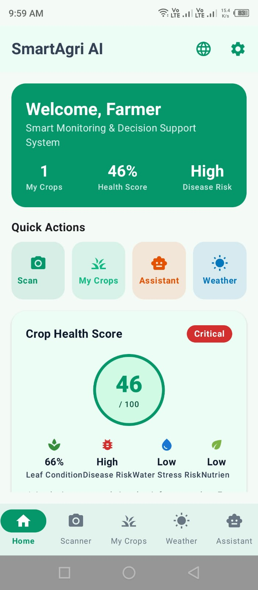

# SmartAgri-AI

AI-powered Android application for crop monitoring and intelligent agricultural decision support.

## What is in this repository

- `ml/train_crop_model.py` — TensorFlow/Keras training script (MobileNetV3Small transfer learning, 224×224 input, 12 classes, 15 epochs)
- `ml/export_tflite.py` — export script for the on-device TFLite model
- `docs/ARCHITECTURE.md` — system architecture
- `docs/RESEARCH_CONTEXT.md` — research background
- `screenshots/` — app UI screenshots

## App Screenshots


*Home dashboard — crop health score and quick actions.*


*AI Crop Health Scanner — take a photo or choose from gallery, then run AI analysis.*


*My Crops inventory.*


*Micro-climate weather with 5-day agricultural forecast.*


*Agri AI Assistant — farming advice chat.*

## Companion app

The offline Android prototype that runs the model on-device lives in the `plant_disease_research_app` repository (Flutter, MobileNetV3Large, fully offline inference).

## Training

```bash
pip install tensorflow
python ml/train_crop_model.py
```

Configure the dataset paths in the script before training.
